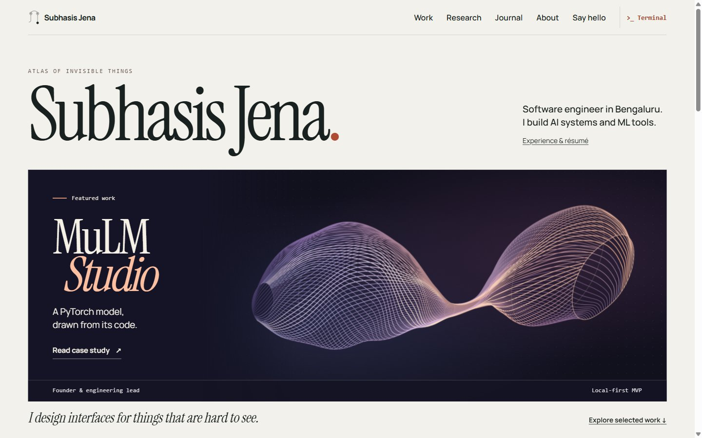
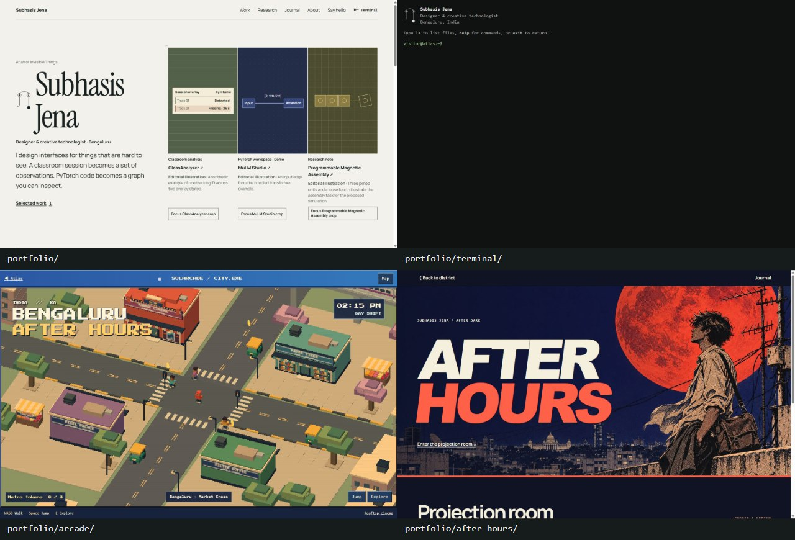
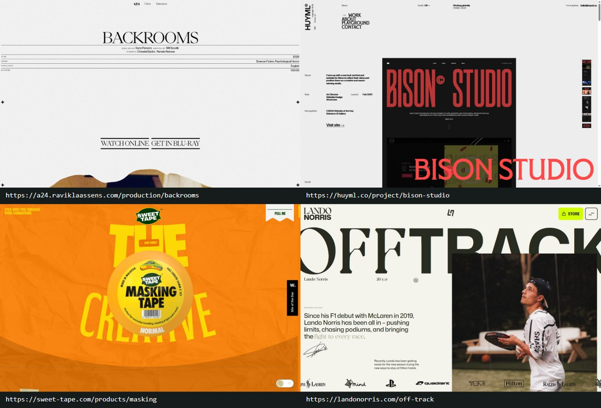

# Atlas of Invisible Things

## Implemented direction · November 2026

Lead with Subhasis’s name, engineering practice in Bengaluru and MuLM Studio. The cover carries one signature object into the case study. A recruiting visitor can open the résumé immediately. A curious visitor can follow the object into an actual shape check, read the public contribution and spend time in the terminal or the city.

| Surface | Design and behavior in the build |
|---|---|
| Editorial cover | Instrument Serif and Manrope on warm paper. The oversized name ends in a clay-colored full stop. MuLM Studio is set in upright and italic type on an indigo print. Copper and lilac contours converge where the shape narrows. The art is an original illustration. |
| Studio study | The same named plate travels to the case introduction in supporting browsers. The study links a public commit and distinguishes the studio founder role from the demo contribution. A visitor can switch the example output from 128 to 64 features and read the diagnostic result. |
| Input and motion | Entry typography has staggered cues. Discrete vertical wheel steps ease with a critically damped spring. Touch and fine-grained scrolling follow the browser. The shader interpolates pointer and scroll changes and rests when settled. The vector print remains available with reduced motion, context loss or JavaScript disabled. |
| Terminal crossing | Drag horizontally just under one-third of the viewport to preview and cancel. At 32% the opposite edition opens. Both editions retain a direct keyboard route. Entering from a case carries its file, including a return destination for a section anchor. |
| Journal and research | The current post has a distinct paper inset on the homepage. Research titles and journal headlines carry across their index and detail pages. Authors retain their shareable URL and article snapshot. |
| After hours | The city lives behind a slit of arcade artwork in the footer. Focus or hover opens it wider. The city and rooftop retain their own typography, controls and visual identity. |
| Experience | Dates and roles come from the supplied résumé. The public print view, terminal and Piper use the same experience data. The direct professional contacts are LinkedIn and GitHub. |

The reference study and original Track 01 storyboard below record the exploration leading to this edition. The résumé review changed the flagship from ClassAnalyzer to MuLM Studio. The later storyboard timings, alternate figures and performance budgets remain proposals. Verification outcomes and implementation changes are in [the edit trail](EDIT_TRAIL.md).

## What the references teach

Playwright MCP was used to inspect the four supplied landing pages at 1440 × 900, compare opening and scrolled states, check composition at 390 × 844, and open an interior route on each site. Narrow Chromium viewports establish layout; physical touch feel and mobile GPU performance still need device testing. The visual observations do not establish the references’ underlying libraries, shaders or easing values.

| Reference | Observed behavior and composition | Translation to this portfolio |
|---|---|---|
| [A24 archive](https://a24.raviklaassens.com/) · [Backrooms](https://a24.raviklaassens.com/production/backrooms) | Backrooms occupied the central illustrated disc, with another disc cropped at the right edge. A wheel gesture brought The Invite into the center, moved Backrooms down-left and changed the credits and quotations. The detail page used a centered title, thin metadata rules and generous white space. At phone width, credits sat at the top and navigation at the bottom. | Give each project one recognizable object. Update its title, evidence and destination from one selection state. Carry its artwork into the detail page. Use the glimpse of an adjacent sheet to invite exploration. |
| [Huy Phan](https://huyml.co/) · [Bison Studio](https://huyml.co/project/bison-studio) | A small illustrated figure appeared to push a black-and-white boundary across the large red name. The Bison project placed small credits at left, a tall image in the center, thumbnails at right, and red lettering across the image boundary. | Make the Atlas mark participate in the action. Its hanging endpoints become registration marks for aligning a sheet. Let the title cross the artwork boundary on wide screens while the quieter credits remain still. |
| [SweetTape](https://sweet-tape.com/) · [Masking tape](https://sweet-tape.com/products/masking) | A yellow roll sat in front of skewed lettering on lime paper. Scrolling revealed cardboard, a taped lemon print and patterned material. The masking tape page changed to orange, with lettering behind the roll. The material made the visible pull tab feel plausible. | Derive each gesture from the subject. Scrub a classroom observation through time, trace a tensor edge, align magnetic units. Give each project a distinct response to the same underlying input system. |
| [Lando Norris](https://landonorris.com/) · [Off Track](https://landonorris.com/off-track) | Moving helmet fragments and a portrait shared facial alignment. Wheel input led into a dark typographic chapter. The phone view kept the face large and a lock control near the thumb. Off Track combined drastically oversized type with an informal photograph and a compact biography. | Align the printed portfolio and CLI around the same mark and current file. Hold that identity still while its medium changes. Let the entertainment district have a different scale and rhythm. |

## Baseline and priorities

The current city already uses a Three.js renderer, instanced geometry and a delta-time camera follow. The editorial styles already request cross-document view transitions and animate entrances. The highest-value change is to **carry a specific piece of evidence across a navigation**. Today the edition gesture translates the body by at most 60 px, resets it, and then navigates. Nothing reveals the destination under the visitor’s finger.

| Surface inspected | Preserve | Priority change |
|---|---|---|
| Home | Exact logo, editorial name, first-person positioning, green/blue/olive figures. | Three crops have similar weight, long captions and separate focus buttons. Give one project enough space to demonstrate a behavior; retain two selectable neighboring edges. |
| Work index and both case studies | Real study, repository and demo links; explicit attribution. | The index begins with a long interval before visual evidence. Both cases use much the same opening hierarchy. Establish the tracking timeline or the graph edge in the first screen. |
| Both research pages | Distinction between a hypothesis and a measured result. | Magnetic Assembly has a figure; Tissue-Based Language Models proceeds into a largely text-only test. Give the latter an explicitly illustrative disagreement diagram. |
| Journal index, article and About | Strong article measure, share and snapshot actions, direct biography. | The single journal entry sits far below its masthead. Bring the newest entry up. Use the mark to connect the biography and practice section. |
| Terminal | Prompt, scrollback, original mark and selectable text. | Choreograph the arrival. Once the prompt appears, keystrokes should paint immediately. |
| Bengaluru and rooftop | Local clock, voxel streets, Purple Line train, storefronts, scanlines and vermilion moon. | Fold the game title away on first movement. Connect the cinema facade to the rooftop scene through a shared aperture. |
| Phone home and 404 | Recognizable identity and clear recovery links. | Terminal wraps to an isolated third masthead line on the phone home. Compact the navigation and expose useful project imagery earlier. Keep recovery immediate. |

The public editorial routes, both studies, both research notes, journal, sample entry, About, terminal, city, rooftop and 404 were visually inspected. The authenticated writing desk was reviewed from source; its private screen was not captured.

## Composition and materials

**Paper is the front door.** Each featured project is a sheet of tracing paper over a colored working figure. An annotation becomes legible as the layers align. At rest the composition should look complete enough to print. Use the original diagrams as the hero art.

**The shell is the reverse of the sheet.** A horizontal drag exposes the terminal. The mark and project identity survive the crossing. Inside, use one text column and one insertion point. Piper replies in scrollback.

**The city is a destination.** The footer mark and discovery flow lead into a separate 3D world. The rooftop belongs inside this world. A horizontal edition swipe always means paper ↔ terminal.

| Element | Desktop | Phone |
|---|---|---|
| Layout | 12 columns, 4vw outer margin capped at 72 px, 16–24 px gutters. Identity in columns 1–5; observation sheets in 6–12. | 4 columns, 20 px margins. Brand and edition switch share a row. At default text size, reveal part of the first working figure within an 844 px viewport. Allow natural reflow at larger text sizes. |
| Type | Instrument Serif for the name, case titles and questions; Manrope for body and actions. Home name 88–128 px, case titles 64–104 px, body 18–20 px. Articles 58–68 characters wide. | Home name 54–76 px, titles 42–64 px, body 16–18 px. Break long names at word boundaries. Keep meaningful type in HTML. |
| Editorial palette | Existing paper `#f3f1eb`, ink `#18211f`, muted ink `#57605b`, rule `#cdd0c6`. Clay `#a3442d` marks the active observation. Keep the green, blue and olive on the figures. | Same palette. A separated 2 px focus outline remains visible on each figure. Target 4.5:1 normal-text contrast and 3:1 control contrast. |
| Surface | Fine grain at 2–3% opacity on the figure mask. Registration ticks appear where two layers align. Reading surfaces stay clean. | One primary sheet. Neighboring names and previous/next controls work by tap or keyboard. Interactive targets at least 44 × 44 px. |
| Other editions | Near-black shell, local system monospace, actual homepage mark. City uses the beveled blue Solarcade window, Press Start 2P for short headings, warm tokens and crisp HUD. | Reserve thumb zones for motion and actions. Keep the scene center and storefront signs clear. |

## Original storyboard · Home to ClassAnalyzer

| Time from activation | Artwork | Text, input and route |
|---|---|---|
| Rest | Cream tracking panel on green ruled paper. Track 01 has a legible state. Blue and olive sheets expose a narrow edge. | A real link opens the study. A separate accessible control selects a sheet. Hover can preview; tap or Enter can commit. |
| 0–90 ms | The chosen sheet presses down 2 px. Capture its current rectangle, crop and tracking-label position. | Start navigation on activation. Keep the masthead fixed in the composition. |
| 70–310 ms | Expand the crop while anchoring the cream panel. Neighboring sheets slip behind by 12–20 px. The missing-track label stays identifiable. | Outgoing introduction fades over 100 ms. Match the project heading to the destination baseline. |
| 200–450 ms | Resolve into the case figure at its real destination bounds. A registration tick lands beside the missing-track state. Restore crisp artwork. | Reveal the question and contribution 45 ms apart. Move keyboard focus to the destination heading after navigation. |
| Rest in study | A scrubber moves between detected, missing and recovered example states. Label it as a synthetic observation. | Back restores the active sheet and previous list position. Direct URLs start at the completed composition. |

Name the active source and matching destination artwork and heading by project slug for native View Transitions. Give each name to exactly one element per document. Prefer a captured crop with matched object position to stretching a screenshot. If preparation is late, let navigation finish immediately. On unsupported browsers, use the normal link and a short destination reveal. A second click, Back, pointer cancellation or page restoration must discard stale overlays.

## Choreography 02 · Paper to terminal

1. **Attach.** After 12 px of horizontal movement and a 1.6:1 horizontal-to-vertical ratio, attach the paper edge to the finger. Reveal a preview of the actual destination prompt and mark. Preserve the selected file path. Vertical intent releases to native scroll.
2. **Pull.** Across the first 40% of the width the edge follows the pointer one-for-one. Only a 16–24 px strip along the fold loses ink registration. The exposed terminal is already sharp.
3. **Release.** Commit at 32% width, or after at least 48 px and a release velocity above 0.65 px/ms in the correct direction. Otherwise spring back. A normal edition link offers the same destination.
4. **Land.** Replace the preview with the real shell at the same coordinates. Restore the active file. Focus the prompt for keyboard users; touch users open the keyboard by tapping. Reverse the composition to return to the matching editorial project.
5. **Arbitrate gestures.** Exclude fields, selected text, open dialogs, game canvas and the outer 24 px of the phone’s browser-back edge. Release capture on a second pointer, blur or cancellation. Reduced motion changes the route without the fold.

## Custom smooth scroll and physics

Use native document scroll as the authority for reading position, anchors, browser Find and history restoration. Apply custom interpolation to the visual stage and artwork. This gives the project sheets weight without making the visitor wait for a paragraph or link to catch up.

| System | Implementation target |
|---|---|
| Input and measurement | One passive scroll listener records position and timestamp. Normalize the target over measured section entry/exit bounds. Recalculate bounds on resize, font readiness and content changes. Batch layout reads before writes. |
| Frame-independent smoothing | Each active frame uses `p += (target − p) × (1 − exp(−dt / τ))` with seconds as units. Start with τ = 0.105 s for scroll artwork and 0.065 s for pointer tilt. Clamp dt to 0.05 s after interruption. |
| Visual limits | Filter velocity before applying highlights. Cap artwork lag at 18 px, tilt at ±2.5°, and channel separation at 1.5 CSS px. Snap within 0.2 px and stop scheduling frames. |
| Release spring | Start with a critically damped spring, angular frequency 18 rad/s. Carry measured release velocity into the integration. Tune ordinary settle to 220–320 ms with no visible oscillation. |
| Scroll timeline | On the featured stage, 0–20% establishes the sheet; 20–65% moves the inspection window; 65–85% aligns its evidence label; 85–100% releases the stage. Reverse scroll reverses the sequence. No timed scroll lock. |
| Pause and restore | Suspend behind a modal and while hidden. On restored pages, initialize the visual position from real scroll before painting. Keep article text, shell input, city controls and editor textareas outside the controller. |

Use one route-scoped coordinator for editorial motion. CSS or Web Animations handles predetermined transform/opacity tracks. Only input-dependent motion uses a frame loop. Unsubscribe observers and remove transient textures on navigation.

## GPU and shader specification

**Editorial paper pass.** One transparent WebGL canvas is clipped to the active figure. Draw a textured quad from an original, label-free illustration. Supply drag progress, edge position, filtered velocity, resolution and a fixed grain seed. The fragment shader computes distance to the moving edge. Within that band, offset the ink-mask samples in opposing directions, add a soft fold shadow and modulate grain. Outside the band, return the original color. At rest render the matching static figure. HTML supplies live labels, links and accessibility semantics.

**Preparation and ownership.** Bake the three diagram backgrounds at 1× and 2×. Use the same aspect ratio, crop origin and color mapping for shader and HTML outputs. Cache the active texture plus one neighbor. Cap editorial DPR initially at 1.5, allocate after the first readable paint, and dispose on context loss or route exit. Keep city code out of the editorial entry bundle.

**City pass.** Retain the existing instanced geometry and orthographic camera. Render the world to a low-resolution target, then use one composite pass for local-time palette grading and restrained ordered dithering in sky and distance. Let individual storefront light pools break through cool dusk pavement. Composite the map, HUD and text afterward at device resolution. Suspend the world behind panels or reduce it to a still frame.

**Failure mode.** With reduced motion, context loss or sustained slow frames, show the original figure and retain its native links. If the city cannot render, Map still opens each venue. Never wait for a shader to make a destination actionable.

## Route-level direction

| Route | Required visitor experience |
|---|---|
| Home | Name, practice and project evidence immediately visible. One first-entry reveal, at most 550 ms. Returning visitors land on their last selection. |
| Work index | Keyboard focus or pointer selection updates one adjacent figure. Pin it within the index section on wide screens. On phones show it inline beneath the selected row. Keep all external links independent. |
| ClassAnalyzer | Step through the tracking gap, stop at the countdown, read what a reviewer would check. Arrow keys advance the example states. |
| MuLM Studio | Select a tensor connection. A single pulse traces the edge and resolves beside the shape label. In the detail figure, align the expected and received widths so the mismatch can be read. |
| Magnetic Assembly | Advance one illustrated connection at a time. Keep the loose fourth unit, proposed test and hypothesis visible together. |
| Tissue-Based Language Models | Show three illustrative model outputs and the group decision. Toggle one disagreement to demonstrate the hypothesis. No invented performance figures. |
| About and contact | Align the mark’s endpoints beside two areas of practice. One entrance, then quiet reading. Give contact a straightforward link alongside the discoverable city entrance. |
| Journal and article | Carry the chosen headline and date into a 58–68ch reading column over 220–300 ms. The share card uses the same title, date, excerpt and mark. Article text scrolls natively. |
| Owner writing desk | Direct inputs, immediate feedback, clear expiry recovery. Suspend gestures while composing and preserve drafts when help opens. |
| Terminal, Piper, floating help | Keystrokes paint on the next frame. Append selectable responses without artificial typing delay. Preserve scrollback and prompt contents across help. Auto-scroll only when the reader is already at the end. |
| Bengaluru district | Establish the crossroads once. On first movement, fold the title into a location label and ease to the walking camera. Return from a venue to the same position and heading. |
| Rooftop | Use the lit cinema sign as an aperture into the vermilion moon. Keep the direct route. Let the four projection modes change how one scene is read. |
| 404 and exports | Show recovery links immediately. Preserve the public plain-text representation and downloadable article PNG as directly addressable resources. |

## Original prototype brief and acceptance targets

Build **home → ClassAnalyzer → Back → terminal → same case study** as one vertical slice. It tests continuity, history, custom physics, mobile gesture ownership and fallback rendering using real content. Review it as a recording before spreading the effect across the site. Extend next to the other figures, then the journal handoff, then the cinema entrance.

The primary integration points are `src/pages/index.astro`, `src/components/WorkFigure.astro`, `src/components/EditionSlide.astro` and `src/pages/work/[slug].astro`. Keep route content in Astro and the actual city loop in `src/game/district.ts`. Preserve the existing logo, native URLs, share links, owner checks and terminal file mapping.

| Verification | Pass condition |
|---|---|
| Continuity | Record the vertical slice at 1440 × 900 and 390 × 844. Inspect activation, midpoint and rest. The tracking label is identifiable throughout. No white flash, duplicate logo or snap-back. Back restores the active slug and scroll position within 8 CSS px once layout settles. |
| Interaction | In Playwright, drag 20% and release slowly, then drag 40% and release. First cancels, second commits once. Test vertical touch, reversal, two quick links, Back mid-transition, a selected paragraph, an open dialog and focus loss. The next action must work without a second click. |
| Accessibility | Repeat using keyboard only, reduced motion and 200% zoom. All project evidence, routes and controls remain accessible. Escape closes floating help and returns focus to the unfinished prompt. |
| Performance | Profile a warm ten-second scroll and drag on a named desktop and physical mid-range phone. Target p95 frame interval ≤20 ms for 60 Hz editorial motion and ≤36 ms for the 30 fps city. Record DPR, hardware, browser, thermal state and scene. These are targets, not measurements. |
| Delivery | Target field LCP ≤2.5 s, INP ≤200 ms and CLS ≤0.1. Under a cold throttled load, the title and study link appear before the shader. Force context loss, background and restore, then open five studies. Inspect active canvases, frame callbacks and retained textures for leaks. |
| Visitor review | Ask a new visitor to identify Subhasis’s contribution, locate one research question, switch editions and return to the same project. Then ask what they remember visually. Look for a specific project and its behavior in their answer. |

**Definition of done.** A visitor can follow a missing observation from the home sheet into the case study, explain the design decision, and find their way back. The terminal tells that same story in plain text. The city rewards a detour without getting in the way of either portfolio.
